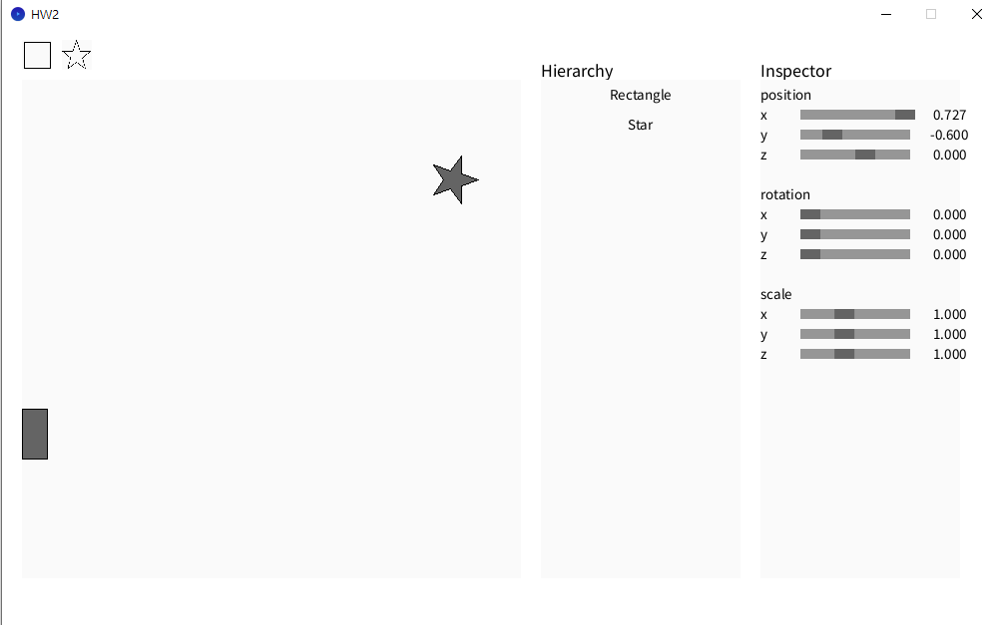
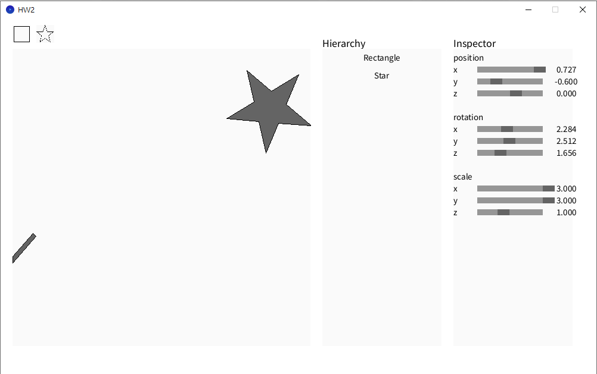
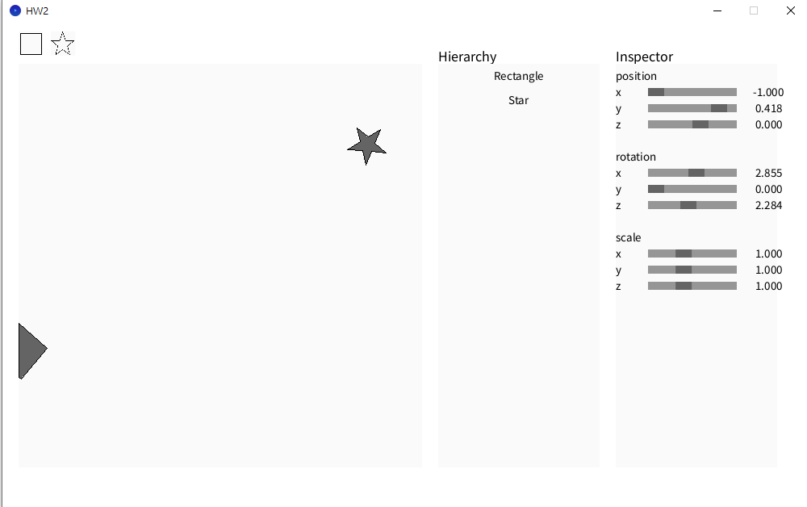

# 115522154_computerGraphic_HW2

## Completed Tasks
- Translation Matrix
- Scaling Matrix
- Rotation Matrix (X, Y, Z)
- Find the Boundary of a Polygon (Bounding Box)
- Point-in-Polygon Test
- Sutherland-Hodgman Polygon Clipping

## Screenshot
(Include Polygon Filling , Polygon Clipping  )
| Translation | Scaling | Rotation |
|:---:|:---:|:---:|
|  |  |  |

## Implementation

### Transformation Matrix

| Transformation | Method |
|---|---|
| Translation | 4×4 Translation Matrix |
| Scaling | 4×4 Scaling Matrix |
| Rotation | Rotation Matrices for X, Y, and Z Axes |

#### Translation Matrix

For translation, I first create an identity matrix using `makeIdentity()`.

Then, I put the x, y, and z values of the translation vector into the last column of the 4×4 matrix. This allows the position of a shape to move along the three axes.

#### Scaling Matrix

For scaling, I also start with an identity matrix.

Then, I replace the first three diagonal values with the x, y, and z values of the scaling vector. These values control the size of the shape along each axis.

#### Rotation Matrix

For rotation, I implemented three functions: `makeRotX()`, `makeRotY()`, and `makeRotZ()`.

I used `cos(a)` and `sin(a)` to calculate the matrix values. Each rotation matrix changes the coordinates around its corresponding axis while keeping that axis unchanged.

The current `localToWorld()` function applies Z-axis rotation when drawing shapes. The X-axis and Y-axis rotation matrix functions are also implemented separately.

### Bounding Box

For the bounding box, I used a `for` loop to check the vertices of a polygon.

I compare their x and y coordinates to find the minimum and maximum values. Then, I return two `Vector3` values to represent the bounding area.

This allows the renderer to check only the area around the polygon instead of checking the entire canvas.

### Point-in-Polygon Test

For polygon filling, I used the Ray Casting Algorithm based on the odd-even rule.

First, I go through every edge of the polygon. For each edge, I check whether it crosses the horizontal line passing through the point.

If it does, I calculate the x coordinate of the intersection and check whether the intersection is to the right of the point.

I count the valid intersections. If the count is odd, the point is inside the polygon; otherwise, it is outside.

I used this result to fill the inside of the Rectangle and Star shapes.

### Sutherland-Hodgman Polygon Clipping

For polygon clipping, I used the Sutherland-Hodgman Algorithm to keep shapes inside the canvas boundary.

First, I go through each edge of the clipping boundary. Then, I check each edge of the current polygon.

I use the 2D cross product to determine whether the start and end points are inside or outside the boundary. There are four cases:

- Inside to Inside: keep the end point.
- Inside to Outside: keep the intersection point.
- Outside to Inside: keep the intersection point and the end point.
- Outside to Outside: do not keep any point.

When an edge crosses the boundary, I calculate the intersection point using linear interpolation.

After each clipping boundary, I use the output vertices as the input for the next boundary. Finally, I return the vertices of the clipped polygon.

## LLM Assistance

I used ChatGPT to help me understand transformation matrices, the Ray Casting Algorithm, and the Sutherland-Hodgman Algorithm. It also helped me debug code issues and improve the English descriptions and organization of this README.md.

I reviewed the code and tested the implemented functions in Processing.
